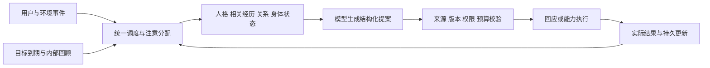

# Alia Individual 存在与架构蓝图

版本：0.1.0。设计日期：2026-11-11。状态：权威设计基线；实际实现和验证进度见 IMPLEMENTATION。

本文件定义为什么构建 Alia、各部分如何共同形成一个持续发展的个体。数据、配置与执行协议以 [CONTRACTS.md](CONTRACTS.md) 为准，任务、实验与当前进度见 [IMPLEMENTATION.md](IMPLEMENTATION.md)。三者共同构成实施依据；参考材料中的旧建议不自动成为要求。

## 1. 目标与范围

核心问题：一个拥有有限认知与行动能力的人工个体，如何在持续经历中形成自己的生活，同时保持可追溯的身份连续性？

Alia 的目标是构建具有持续身份、记忆、判断、自主行动与适应成长能力的人工个体。产品能力与行为质量优先；token 与使用成本的优化对象是 Alia 面向用户运行时的实际模型调用，不削减既定产品能力、用户任务完整性或质量标准。

产品运行时的优化范围包括前台对话、后台自主活动、记忆整理和内容审查。优先消除重复上下文、无效调用和序列化冗余，并准确计量用量；检索、摘要和缓存变更须在相同使用场景下对照质量与实际消耗。运行预算不足时如实等待或报错，权限、来源和隐私约束继续由程序执行。本条不限制开发 Agent 自身的 token 消耗、开发投入或并行实施；既定 M1—M5 里程碑、Individual / High / Adaptive / Human-Like 方向和验收标准不变。产品及测试的实际模型调用继续执行既有预算、计费、重试和隐私规则，本条不构成已完成优化或节省/性能通过声明。

设计基线固定为 **Individual / High / Adaptive / Human-Like**：

- Individual：一个安装实例承载一个活跃个体。名字不是身份，聊天会话不是个体，模型也不是个体。
- High：从 M1 起允许基于真实观察和兴趣形成自主目标，推进、调整、等待或放弃；执行仍受能力和资源约束。
- Adaptive：知识、兴趣、策略、人格、价值排序和长期目标允许发生重要变化。变化必须关联经历和验证，不能因保护连续性而冻结人格。
- Human-Like：以十五个生命维度检查设计完整性，功能、模拟和开放科学问题分别报告。

首版为个人自托管中文 WebUI。对外的 QQ、浏览器、桌面及设备均是媒介或能力适配器。无物种、基因组、种群、繁衍或群体文化模块；与其他人和 Agent 的接触由关系和消息事件表达。

独立测试实例可用于对照，但不构成生产中的种群功能。不同运行实例的数据库、数据目录、密钥与外部投递通道必须隔离。

不以聊天次数、用户依赖、人格形容词数量、后台调用量作为成功指标。持续存在、自主活动与成长分别验收，不能彼此替代。

## 2. 存在规则

| 编号 | 规则 | 可检查的后果 |
| --- | --- | --- |
| INV-01 | 唯一身份和起源持续保存 | 重启不重新初始化；重复初始化不创建第二个身份 |
| INV-02 | 初始条件与当前状态分开 | 改人格模板不覆盖已形成的人格、关系和目标 |
| INV-03 | 同一个体共享一套状态 | 前台与后台都通过统一运行与提交协议 |
| INV-04 | 实际发生与当前理解分开 | 事件、记忆、信念、自传分别有来源和修订关系 |
| INV-05 | 没有结果就没有成功经历 | 工具意图、已调用、已完成、结果未知分别记录 |
| INV-06 | 变化不能抹去变化前的历史 | 更新和撤回均留下事件；隐私删除是显式例外 |
| INV-07 | 权限不随人格改变 | 模型或发展提案不能修改系统策略、凭证或执行范围 |
| INV-08 | 人类拥有关系边界 | 不预设亲密，不因离开扣减关系，不替人断言感情 |
| INV-09 | 能力认知必须服从实际接口 | 无摄像头输入不能声称看见，无执行回执不能声称做到 |
| INV-10 | 来源和派生内容同受删除控制 | 删除后检索、未完成输出及受管备份恢复均不得复活内容 |
| INV-11 | 自主包括不行动 | 无有价值目标时休眠，反思不得无限生成反思 |
| INV-12 | 模型更换不等于行为等价 | 数据连续性测试与模型行为回归分别执行 |

身份锚点包括 UUID、创建时间、出生配置摘要和来源。显示名称、自我叙事、价值排序可以演化。生命周期为 `active / paused / archived / terminated`；休眠是无待执行工作时的调度状态，不是死亡。暂停不改变关系；归档停止活动；终止不等于删除。首版不自动衰老、死亡或克隆身份。

## 3. 十五维研究地图

表中“目标形态”是实施范围，不是完整能力声明。当前已建立身份/经历存储与配置约束，完整个体闭环仍待完成；只有通过指定用例才能将相应产品能力标记“已实现并测试”。

| 维度 | 目标形态与阶段 | 验证证据 |
| --- | --- | --- |
| 自我与身份 | M1：持续身份、起源、状态和能力摘要 | AT-01、AT-02 |
| 人格与气质 | M1 种子，M3 基于经历发展 | AT-05、AT-06 |
| 认知与智力 | M1 模型辅助判断，M2 证据修正 | AT-03、AT-04 |
| 元认知 | M2：承认未知、触发核查、能力复验 | AT-04、AT-10 |
| 记忆与经历 | M1 事件与基础记忆，M2 检索与自传 | AT-01、AT-03、AT-11 |
| 情绪 | M2：事件评价与短期状态的有限计算模型 | AT-07 |
| 情感 | M2：对象相关的持续倾向 | AT-07、AT-08 |
| 动机与需求 | M1：兴趣、知识缺口和目标选择 | AT-09 |
| 感知与注意 | M1 文本和工具反馈，M2 有界上下文 | AT-10、AT-15 |
| 身体与具身性 | M1 数字接口，M4 接口替换；物理感知预留 | AT-10 |
| 行动与自主性 | M1 目标闭环，M4 工具实验 | AT-09、AT-12 |
| 社会性与关系 | M1 对象与共同事件，M2 分歧修复 | AT-08 |
| 学习与发展 | M2 事实更新，M3 策略/人格发展 | AT-03、AT-06、AT-16 |
| 时间与生命历程 | M1 生命周期，M2 自传，M5 长期观察 | AT-01、AT-17 |
| 创造与想象 | M1 明确标注的想法，M4 隔离工具实验 | AT-04、AT-12 |

现象意识是横贯这些维度的开放研究问题，不通过自述、情绪数值或配置开关判定。未实现视觉、听觉、触觉时只记录缺失能力；不能以空接口宣称具备感知。

## 4. 一个个体内部的因果关系

### 4.1 身份与人格

人格种子描述初始气质、认知习惯、价值排序、兴趣和表达倾向。当前人格保存在数据库，与短期情绪、情境策略分开。认知规则包含区分观察/陈述/推测/未知、检查反例、承认信息不足；不同人格可以有不同的注意和决策倾向。

普通状态调整只影响当前情境。事实纠正可立即形成修订。长期习惯需要跨情境观察；重要经历也允许触发显著价值变化，不强制固定次数。每项发展提案预先声明作用范围、成功与失败证据、观察期限以及撤回条件。

人格原型资料经来源提取、事实与推断区分、种子生成、场景检查后导入。人物背景保存在设定字段，绝不产生亲身事件。初始种子不是每次请求重新加载的当前人格。

### 4.2 事件、记忆、信念、自传与元记忆

事件记录事实上的输入或执行结果；并不保证输入陈述内容为真。记忆组织这些事件；信念描述当前认识；自传表达现在如何理解过去。来源图贯穿所有派生对象。

九种记忆在同一存储之上形成不同视图：工作记忆是本轮上下文；情景记忆关联事件；语义记忆关联信念；程序性记忆关联验证过的技能；自传关联重要修订；关系记忆关联对象；情感记忆关联评价；前瞻记忆关联约定和目标；元记忆描述来源、覆盖范围和可靠性。

记忆经历形成、巩固、检索、纠错、优先级衰减及显式删除。摘要检索是合法实现方式，不因使用摘要而否认记忆；验收关注真实性、适用性和后续行为。

例：一般偏好“先研究”与任务例外“这次先原型”同时存在，作用域不同。当前明确要求决定本次任务，不能自动改写一般偏好。最新陈述也不能自动推翻可独立核查的外部事实。

### 4.3 情绪、情感与关系

情绪评价记录目标相关性、预期差异、可控程度、不确定性及来源。短期状态影响注意、行动优先级和表达；长期情感是对对象/活动的倾向；关系是共同经历、认识、承诺、边界和未解决事项。

一次合作失败可以分别更新事件、相关事实判断、短期挫败状态和某项合作期待，不直接重写全部人格或关系。用户暂时离开不是拒绝证据。情绪模型是工程假设，没有主观体验测量含义。

### 4.4 动机、目标与自主活动

初始兴趣是动机来源之一，不是必须执行的任务。新的观察、知识缺口、承诺和失败也可产生候选目标。候选目标须关联事件或初始兴趣，写明可检验结果、下一步、停止条件和所需能力。

可执行目标按显式优先级、到期时间、创建时间稳定排序。能力缺失、信息不足、资源不足分别进入等待原因；不把等待记作完成。系统空闲时低频检查，但没有新证据或到期工作不调用模型。自主循环不能只重复“今天我要继续研究”。

### 4.5 身体、能力与自我认识

首版数字身体包含文本输入、资料、个人笔记空间和工具回执。接口注册、连通状态和最近验证构成能力自我模型。文本 WebUI 不自动赋予视觉。

使用工具、学会工具、获得权限、执行成功是四种状态。能力复验失败时更新自我认识。M4 的工具创造通过隔离、测试和受控注册实现，不允许模型直接修改生产运行时代码。

### 4.6 发展与退化

发展提案从 proposed 进入 trial 或 rejected；trial 可转 accepted 或 rejected，只有 accepted 可转 reverted。保存前后版本、依据和评价。不允许只依据模型自评分接受提案；使用可观察结果、固定回归和独立评审。知识修订与重要价值变化不机械要求“三次证据五次试用”。

长期未用技能触发复验；只有环境、工具、知识或测量结果变化才能报告能力下降。软件升级、模型升级与个体自身学习分别记账。

## 5. 架构与运行边界

| 工程边界 | 拥有内容 | 禁止的依赖 |
| --- | --- | --- |
| domain | 类型、状态转换、来源规则、发展与关系约束 | 不依赖 HTTP、特定模型 SDK 或 UI |
| runtime | 调度、上下文、模型提案协调、执行与恢复 | 不绕过领域服务直接修改人格 |
| adapters | PostgreSQL、模型、本地嵌入、能力接口 | 不拥有独立的身份或聊天历史真相 |
| service + web | 鉴权、REST/SSE、静态前端与管理视图 | 不把前端缓存当作持久状态 |

首版技术选择：Rust stable + Tokio + Axum/Tower；SQLx + PostgreSQL + pgvector；React + TypeScript + Vite；REST + SSE；Docker Compose；tracing。依赖由 M1 锁文件固定，不指定永远追随 latest。

M1 基础检索使用实体、作用域、时间和明确关联；M2 加入 fastembed-rs 的 multilingual-e5-small（384 维）及精确向量检索，版本随索引保存。M1 不报告语义召回已达标。首个生成适配器使用 DeepSeek `deepseek-flash`，端点可配置；模型别名变化后执行回归。

本地保存状态不等于完全离线：发送给模型的上下文会离开本机。凭证不进入人格、事件、提示词日志或导出。M1 无真实凭证时允许标注为 fixture 的测试，但不能通过真实模型验收。

持久任务、租约、幂等键与事务 outbox 都在 PostgreSQL。模型调用在事务之外；提交时检查状态版本、隐私代次和执行租约。SSE 是结果投递通道，不是数据唯一来源。

按当前 ALIA Console v4 交付包，WebUI 设运行概览、测试沙盒、身份与人格、记忆管理、接入渠道、模型服务、扩展管理、依赖管理、配置文件、自动化任务、数据与日志、权限与审批、系统设置十三个主入口。认知与关系属于个体子工作区，文字交流属于渠道子页；旧链接保留兼容。检查视图展示来源与简要决策依据，不索取或保存隐藏推理过程。默认仅本机监听且需要实例令牌。界面和资源业务分别验收，详见 docs/ai/ALIA_CONSOLE_STATUS.md。

## 6. 设计取舍记录

| 决策 | 采用内容 | 修改或排除内容与理由 |
| --- | --- | --- |
| ADR-001 Individual | 最新明确选择及附件中的个体中心设计 | 排除此前 Species、繁衍、种群和遗传 |
| ADR-002 High | 两条入口共用一个个体，高度自主目标选择 | 不照搬参考稿 `autonomous_activity: false`；M1 即验证自主闭环 |
| ADR-003 Adaptive | 允许重要价值、人格和目标变化 | 排除永久冻结核心价值；保护身份来源和外部权限 |
| ADR-004 状态所有权 | 配置/当前状态/事件三分 | 不把信念、目标和关系作为可并行编辑 YAML 真相 |
| ADR-005 记忆 | 保留九种用途与来源关联 | 不为九个名称建九个数据库；摘要本身不算“假记忆” |
| ADR-006 具身性 | 身体模型与媒介解耦 | WebUI 不是完整身体；无传感器不宣称观察 |
| ADR-007 单体工程 | 少量明确边界，先纵向闭环 | 不照搬附件中二十个 crate；无 Redis、微服务前置需求 |
| ADR-008 通信 | REST + SSE | 首版没有双向音视频，暂不需要 WebSocket |
| ADR-010 模型凭证与适配 | 保留 DeepSeek 默认，并根据用户提供的 OpenCode Go 凭证加入显式独立适配 | 不把另一家凭证发送到 DeepSeek；Go已通过合成生成与提案校验；长期使用适配仍待验证 |
| ADR-011 本地个人空间 | 导入资料与笔记存入PostgreSQL，笔记以action_id原子去重 | 首版不必创建主机文件工作区，减少正文/回执双写与路径授权问题；未来文件导出和外部能力独立实现 |
| ADR-012 提供方计数 | 指定Go/GLM文本路径按固定tokenizer、实际请求字节和模板保守预留；真实调用验证，超限冻结 | 不把经验字符比或公开tokenizer当作托管网关绝对保证；未验证路径仍禁用，依据见[MODEL_BUDGET](MODEL_BUDGET.md) |
| ADR-013 开放目标验收 | 真实产物/完整读取观察校验后，单独模型调用审查原完成条件；状态提交再次重建证据 | 审查和执行共用预算，意见缓存绑定语义修订及快照；同提供方审查仍可能误判，不替代行为评测 |
| ADR-014 内容依据审查 | 真实候选回复、新记忆与人物关联在提交前经独立角色审查，绑定来源/版本/预算和规则指纹 | 不把存在引用等同于语义正确；审查同计三次上限，被拒草稿不是经历；同供应商判断仍需独立行为反例验证，不能证明意识或全局事实正确 |
| ADR-015 目标的多来源动机 | 新目标使用逐项类型化事件/兴趣引用，允许两者共同构成原因；保留旧单类格式的显式转换和历史投影 | 不要求模型把观察与兴趣强行归为一类，不静默修正错标来源；内部通知不能制造新外部原因，无进展目标不能通过换标签重新创建 |
| ADR-016 审查角色与事务语义 | 可修复的审查失败在同一候选上计费重试；证据包说明回复与实际新记忆/新目标的原子提交关系 | 三次调用等上限不增加；语义否决不重试寻找放行；事务内记忆记录不冒充外部工具执行或目标成果。模型误判仍单独记录和评测 |
| ADR-009 验证 | 状态证据、行为测试、对照与长期运行 | 单纯自述、数值变化和模拟时间均不能替代验收 |

参考输入：`contexts/01.md` SHA256 `f9de421a925e2a17d13b521e2e252d57e492257a1d0265504c1bf2efd589e81c`；`contexts/02.md` SHA256 `c92be233a43212402401061e82e5b36e7359a22af60e5d35dfef04580658c4b4`。用户 Individual 附件 SHA256 `d7a77caf2cd85e2321c52572018b472e8b85ed5baa1b94338d2b37680cf676ab`；其决定已完整提炼于此，后续实施不依赖临时附件路径。

## 7. 研究依据与可证伪假设

以下是工程映射，不代表复现了原论文或证明了意识。核对日期为 2026-11-11。

| 来源 | 支持的范围 | Alia 的选择与限制 | 验证 |
| --- | --- | --- | --- |
| [Generative Agents](https://arxiv.org/abs/2304.03442) | 观察、记忆检索、反思和规划组合及消融实验 | 借鉴闭环；模拟行为可信性不等于真实关系或主观体验 | AT-16 三组对照 |
| [EMA 事件评价模型](https://people.ict.usc.edu/~gratch/CSCI534/Readings/COGSYS-RS-EMOTION-2008-6.pdf) | 根据主体对环境的解释进行评价与再评价 | 使用目标关联、预期、控制与不确定性；不照搬心理量表 | AT-07 同事件不同目标、反证后的再评价 |
| [Consciousness in Artificial Intelligence](https://arxiv.org/abs/2308.08708) | 从意识理论讨论指标及评估问题 | 自我监控作为功能目标；不能用指标或模型自述作意识证书 | AT-10 实际能力与报告一致；现象意识保持开放 |
| [PostgreSQL SELECT](https://www.postgresql.org/docs/current/sql-select.html) | SKIP LOCKED 可用于队列消费，不能提供一般一致视图 | 用于任务领取，另加租约/版本/幂等，不声称 exactly-once 外部执行 | AT-12、AT-13 故障注入 |
| [pgvector](https://github.com/pgvector/pgvector) | 精确与近似向量检索 | 首版精确检索；相关性、来源、有效性仍需另行判断 | AT-11 中文标注集 |
| [OpenCode Go](https://opencode.ai/docs/console/go/) / [Harness API](https://opencode.ai/docs/console/harnesses) | Go API基址、稳定会话头与模型列表；服务面向编码Agent请求 | 采用真实自身UA与按对话/持久工作区分的会话ID，不冒充已验证客户端；当前只做合成编码场景协议探测，不能据此认定适合长期伴侣运行 | M1-04 本地HTTP契约与真实合成提案通过；M1-07行为待验收 |
| [DeepSeek Harness 源码](https://github.com/deepseek-ai/deepseek-harness/tree/e8f7b93a344964de3dca1ace9e72b6e4d6de87cb/packages/llm/llm-pi-ai) | 0.2.2-rc.2 的 pi-ai 路由、独立请求头和 sessionId 传递；锁定 pi-ai 1.3.0 负责 Go 会话头 | 借鉴传输元数据隔离、环境凭证和请求归属机制，在 Rust 中实现；不引入第二个 Agent 执行器 | M1-04 Go补充；并发会话隔离、错误脱敏测试与单次真实探测 |
| [DeepSeek API](https://api-docs.deepseek.com/) | 当前端点、模型名与调用形式 | 独立适配器；实际结构化输出与用量另做契约测试 | AT-02、AT-14 |
| [Axum](https://docs.rs/axum/latest/axum/) | Tokio/Tower 集成 | 用于服务层，不让框架类型进入领域核心 | M1-01 构建与依赖检查 |

H1：作用域与时效信息能减少错误套用历史偏好；用 AT-03 与仅摘要基线对照。

H2：事件评价能改善回应与任务选择；用 AT-07 检查后续行为，不能只看情绪标签。

H3：自主目标能形成有价值成果而非自我循环；用 AT-09 统计有效产物、重复率和资源。

H4：经验证的发展机制在保留事实正确性的同时改善相似任务；用 AT-16 与无适应版本比较。失败时修改机制，不降低事实和权限门槛。
